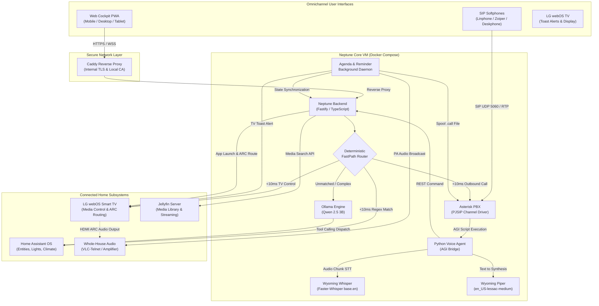

# Neptune-AI: Edge-Native Autonomous Smart Home Intelligence

[](LICENSE)
[](#high-level-architecture)
[](#technology-stack)
[](#architectural-decisions-deterministic-fastpath-vs-llm-fallback)
[](#sip-telephony-architecture)
[](#smart-home--entertainment)

**Neptune-AI** is a self-hosted, edge-native home operating intelligence engineered for privacy-first smart home control, low-latency voice interaction, full-duplex SIP telephony, multi-room audio, and smart media orchestration. 

Built entirely to run on on-premise hardware without commercial cloud APIs or proprietary voice satellites, Neptune-AI pairs a deterministic sub-10ms **FastPath** intent router with a local small language model (**Qwen 2.5 3B**) for natural language reasoning. It bridges Home Assistant, an Asterisk PBX phone exchange, LG webOS smart TVs, Jellyfin media streaming, and whole-house amplifier hardware into a unified, responsive private assistant.

---

> [!NOTE]
> **30-Second Overview (`v0.1.0`)**
> - **What it is:** A 100% local, privacy-first home automation, entertainment, reminder, and SIP telephone AI assistant orchestrating Home Assistant, Jellyfin, Ollama (`qwen2.5:3b`), Wyoming Whisper/Piper, and Asterisk 20.
> - **Why it differs:** Sub-millisecond deterministic `FastPathRouter` handles lights, climate, TV control, timers, locks, and intercom calls *before* touching the CPU-bound LLM — and isolates dangerous lock/cover actions behind `PermissionsGateway` confirmation flags.
> - **Supported hardware:** Tested architecture targets x86-64 Linux hosts (e.g., Debian 12 VM on Proxmox VE with AVX2 CPU for `faster-whisper` and Ollama); minimum ~8 GB RAM for the AI VM + Home Assistant on your LAN. No GPU required.
> - **What works vs. planned:** See the [Feature Status Table](#feature-status) below before deploying.
> - **Get started / Help:** Follow [INSTALLATION.md](./INSTALLATION.md) (Standalone Docker Compose or Proxmox VE), run tests via [CONTRIBUTING.md](./CONTRIBUTING.md), or ask questions in [GitHub Discussions](https://github.com/Spender890/neptune-ai/discussions).

<a id="feature-status"></a>
### Feature Status

| Subsystem / Feature | Status | Verification & Scope |
| :--- | :--- | :--- |
| **Deterministic FastPath Router** (`lights`, `switches`, `climate`, `TV`, `timers`, `locks/covers`) | **Tested** | 7 FastPath unit tests pass (`backend/test/neptune.test.ts`; 17 backend tests total across 8 suites); local CPU microbenchmark verified (`scripts/benchmark-fastpath.ts`) |
| **Permissions Gateway & Consequential Entity Guard** | **Tested** | Unit-verified strict regex validation, explicit wildcard matching, and `consequential_entities` confirmation gating |
| **Backend API & Auth Middleware** (`Fastify`) | **Tested** | Route registration, input bounds, and optional `NEPTUNE_API_KEY` verification tested with mock Fastify & HTTP doubles; live container startup awaits Linux CI/Docker run |
| **Home Assistant, Jellyfin & Ollama HTTP Clients** | **Tested** | Verified against mock `http`/`https` responders and timeout paths; live LAN device execution unverified in offline audit |
| **Reminders & Agenda Daemon** | **Tested** | Atomic JSON persistence and sanitized Asterisk `.call` file generation tested locally; physical speaker/TV playback requires live LAN stack |
| **Asterisk PJSIP Dialplan & Python AGI Voice Bridge** | **Tested** | AGI parsing, word-boundary hangup detection, `.call` sanitization, and `StdlibWyomingClient` STT/TTS framing unit-tested; live SIP call audio unverified offline |
| **LG webOS TV Integration & ARC Audio Routing** | **Experimental** | Wired via HA `webostv` + Jellyfin `/Sessions`; physical TV verification depends on local LG hardware & pairing |
| **Web Cockpit Static UI** (`frontend/dist/index.html`) | **Experimental** | Text command dispatch and HTML-escaped reminder management implemented; Push-to-Talk mic button is a **Planned** stub (no live Web Audio upload route yet) |
| **Interactive Web Confirmation Flow** (`/api/confirm`) | **Planned** | Consequential lock/cover actions are blocked (`requires_confirmation: true`); two-step confirmation approval endpoint & modal planned for `v0.2.0` |
| **Persistent SQLite Audit Logging** | **Planned** | Currently outputs console/structured stdout logs; persistent SQLite audit log planned for `v0.2.0` |

---

## Table of Contents

1. [Project Overview & Engineering Goals](#project-overview--engineering-goals)
2. [Core Feature Highlights](#core-feature-highlights)
3. [High-Level Architecture](#high-level-architecture)
4. [Mermaid System Architecture Diagram](#mermaid-system-architecture-diagram)
5. [Technology Stack](#technology-stack)
6. [Voice Processing Pipeline](#voice-processing-pipeline)
7. [Architectural Decisions: Deterministic FastPath vs. LLM Fallback](#architectural-decisions-deterministic-fastpath-vs-llm-fallback)
8. [Smart Home & Entertainment](#smart-home--entertainment)
9. [SIP Telephony Architecture](#sip-telephony-architecture)
10. [Universal Agenda & Reminder Daemon](#universal-agenda--reminder-daemon)
11. [Installation & Deployment Guide](#installation--deployment-guide)
12. [Configuration Reference](#configuration-reference)
13. [Measured Performance Benchmarks](#measured-performance-benchmarks)
14. [Hardware Constraints & Edge Sizing](#hardware-constraints--edge-sizing)
15. [Documentation, Security & Community Guides](#15-documentation-security--community-guides)

---

## 1. Project Overview & Engineering Goals

Commercial smart-home assistants (Amazon Alexa, Google Home, Apple Siri) introduce significant architectural drawbacks for security-conscious, latency-sensitive environments:
- **Cloud Latency & Roundtrips:** Standard voice commands travel over public WAN links to hyperscaler datacenters, adding 800ms–2500ms of latency for simple light switches.
- **Privacy Gaps:** Unencrypted voice recordings and ambient room telemetry are streamed to external corporate infrastructure.
- **Walled Gardens:** Limited protocol support prevents seamless integration across legacy PBX systems, custom audio amplifiers, self-hosted media servers, and television operating systems.
- **Fragile Cloud Dependency:** An Internet outage renders local light switches, alarms, and intercoms inoperable.

### Core Objectives
1. **Zero External Data Exfiltration:** STT, LLM reasoning, TTS, and device dispatch execute strictly within the local area network (LAN).
2. **Sub-10ms Deterministic Execution:** High-frequency home automation commands bypass the neural network entirely using an optimized FastPath router.
3. **Hardware Efficiency on Commodity CPU:** Eliminate the need for expensive, power-hungry discrete GPUs by sizing quantized models and ONNX runtimes for AVX2-enabled CPUs.
4. **Unified Multi-Modal Interface:** A single intelligence handles Web PWA voice capture, incoming and outgoing SIP telephone calls, whole-house PA announcements, and on-screen TV toasts.

---

## 2. Core Feature Highlights

- **Dual-Path Intent Engine:** Blends compiled regex rule routing (<10ms) with local LLM function calling (Qwen 2.5 3B) for complex natural language ambiguity.
- **Full-Duplex Asterisk SIP Telephony:**
  - Automated AI Receptionist: Inbound callers are greeted by name via Caller ID lookup, engaging in full conversational voice loops.
  - Proactive Outbound Messaging: Users can instruct the AI via web or voice to *"Call Desk and tell them dinner is ready"*, generating automated Asterisk call spools.
  - Intercom & Extension Dialing: Native softphone routing between mobile apps (Linphone/Zoiper) and room tablets.
- **Smart TV & Multi-Room Audio:**
  - LG webOS Integration: Power status, volume control, app launching (YouTube, Netflix, Jellyfin), and toast notifications.
  - Real-Time TV State Inspection: Ask *"What is playing on TV?"* to query live webOS and Jellyfin active sessions.
  - TV Audio Output Routing: Instruct Neptune to *"Route TV audio through home speakers"*, switching webOS audio output from internal speakers to HDMI ARC / Optical whole-house amplifier.
  - Whole-House Broadcast: High-priority audio broadcast across amplifier speakers via Home Assistant VLC-Telnet bridge.
- **Universal Reminders & Agenda Daemon:**
  - Origin Agnostic: Reminders created via browser or phone call are tracked in a unified store with caller metadata.
  - Multi-Channel Synchronized Dispatch: At expiry, reminders trigger an LG TV toast, whole-house audio announcement, and a proactive SIP call to the target person's extension.
- **Browser-First Web Cockpit:**
  - Zero-hardware client: Responsive PWA utilizing Web Audio API for push-to-talk mic capture and HTML5 playback.
  - Real-time telemetry, TV status cards, intercom quick-dials, and interactive reminder management.

---

## 3. High-Level Architecture

The Neptune-AI ecosystem runs on an Intel Core i7-10700 host (8 physical cores, 16 threads, 16 GB DDR4 RAM) virtualized via **Proxmox VE**:

```
+---------------------------------------------------------------------------------------+
|                                PROXMOX VE HYPERVISOR HOST                            |
|                       16.0 GB Total RAM | Intel Core i7-10700 CPU                     |
+---------------------------------------------------------------------------------------+
        |                                                   |
        v                                                   v
+-----------------------------------+   +-----------------------------------------------+
|  VM 100: Home Assistant OS (HAOS) |   |  VM 101: Debian 12 Minimal (Neptune-AI Core)  |
|  - 2 vCPUs, 3.0 GB RAM            |   |  - 6 vCPUs, 8.0 GB RAM                        |
|  - Zigbee / Z-Wave Gateway        |   |  - Docker Compose Container Stack:            |
|  - State Engine & Device Bus      |   |    * Caddy 2.8 (Internal TLS & Reverse Proxy) |
|  - VLC-Telnet Multi-Room Audio    |   |    * Neptune Backend (Fastify, TypeScript)   |
+-----------------------------------+   |    * Ollama (Qwen 2.5 3B local LLM)          |
                                        |    * Wyoming Whisper (Faster-Whisper STT)     |
                                        |    * Wyoming Piper (ONNX Neural TTS)         |
                                        |    * Asterisk 20 (PJSIP Telephony & AGI)      |
                                        +-----------------------------------------------+
                                                                |
                                                                | Local Gigabit Subnet
                                                                v
                                                +-----------------------------------------------+
                                                | External Media Server: WD Sentinel DX4000     |
                                                | - Debian 12 (Standalone Storage Server)       |
                                                | - Jellyfin Media Server (Port 8096)           |
                                                +-----------------------------------------------+
```

---

## 4. Mermaid System Architecture Diagram



---

## 5. Technology Stack

| Layer | Component | Technology / Version | Deployment Mode | Responsibility |
| :--- | :--- | :--- | :--- | :--- |
| **Edge Gateway** | Caddy | v2.8.4 | Docker container (`neptune-net` bridge) | TLS termination, local mDNS routing, static Web Cockpit hosting |
| **API Backend** | Fastify | v4.26+ / TypeScript 5.3+ | Docker container (Node 20.18.1 Alpine) | Intent routing, subsystem coordination, API key gate, state management |
| **Deterministic Router** | FastPath | Custom TypeScript Engine | In-memory backend module | Sub-millisecond regex matching for lights, climate, TV, calls, locks, timers |
| **Neural Reasoning** | Ollama | v0.4.16 / Qwen 2.5 3B | Docker container (`neptune-net` bridge) | Natural language parsing, conversational reasoning, tool calling |
| **Speech-to-Text** | Wyoming Whisper | v3.8.1 (faster-whisper `base.en`) | Docker container (TCP 10300) | 16kHz mono audio transcription on CPU with AVX2 |
| **Text-to-Speech** | Wyoming Piper | v1.6.2 (`lessac-medium` ONNX) | Docker container (TCP 10200) | Low-latency speech synthesis, faster than real-time |
| **Telephony PBX** | Asterisk | v20 LTS / PJSIP | Docker container (`neptune-net` bridge + UDP RTP ports) | SIP endpoint registration, RTP streams, dialplan routing |
| **Telephony Agent** | Python AGI Bridge | Python 3.11 / `asyncio` | AGI script invoked by Asterisk | Caller ID identification, Whisper/Piper streaming, PBX dialogs |
| **Home Automation** | Home Assistant | HAOS Core (or standalone LAN instance) | Dedicated VM / LAN appliance | Entity bus, Zigbee/Z-Wave orchestration, device state store |
| **Entertainment** | LG webOS TV | webOSTV via Home Assistant | Local Network (Smart TV) | Display controls, app management, HDMI ARC audio redirection |
| **Media Server** | Jellyfin | v10.9 LTS | Standalone NAS / LAN server | Movie/music metadata lookup, remote playback coordination |

---

## 6. Voice Processing Pipeline

Neptune-AI provides unified intent handling across its Text Web Cockpit API and SIP telephone calls:

```
[Audio Input] ──► [16kHz PCM] ──► [Wyoming Whisper] ──► [FastPath / LLM] ──► [Wyoming Piper] ──► [Audio Output]
(SIP Call)        sox resample    (STT: ~1.2s on CPU)    (Decision Engine)    (TTS: ~180ms TTFA)   (SIP Playback)
```

1. **Audio Capture:**
   - **Asterisk Telephony (Live Speech):** Asterisk records the caller's turn to `/var/spool/asterisk/tmp/user_turn.wav` using silence detection (`Record(...,2,7,k)`), dispatched to Whisper STT.
   - **Web Cockpit (Text Command Hub & Reminder UI):** Provides instant text command submission, HTML-escaped reminder management, and status inspection. *(Note: the Push-to-Talk microphone button is currently a client-side UI stub; live Web Audio capture to Whisper is planned for `v0.2.0`.)*
2. **Speech-to-Text (STT):**
   - `scripts/asterisk-voice-agent.py` resamples recorded `.wav` audio to 16kHz mono PCM via `sox` and transmits it over the Wyoming TCP protocol to Whisper.
   - Faster-whisper executes INT8 quantized CPU inference using `base.en` model with beam size 1 for minimum latency.
3. **Intent Parsing & Dispatch:**
   - Text string is evaluated by `FastPathRouter.match()` in under 1 millisecond. If matched, permitted commands execute immediately via Home Assistant/Telephony/Reminders unless gated by `consequential_entities`.
   - If unmatched, the text is forwarded to Ollama (`qwen2.5:3b`) with narrow tool-calling JSON schemas (`ha_set_state`, `ha_set_climate`, `broadcast_announcement`, `telephony_call`, `media_control`).
4. **Text-to-Speech (TTS):**
   - Generated response text is dispatched to Wyoming Piper over TCP.
   - Piper synthesizes 22050Hz raw PCM audio using the ONNX-optimized `en_US-lessac-medium` voice.
5. **Playback Transcoding & Delivery:**
   - **Asterisk Audio:** `sox` transcodes Piper's synthesized output into Asterisk-native 8kHz mono PCM WAV (`-t raw -r 22050 ... -r 8000 -c 1`), streamed into the active call via AGI `STREAM FILE`.
   - **Whole-House Speakers:** Transmitted via Home Assistant VLC-Telnet / media player TTS bridge (`SPEAKER_ENTITY_ID`) directly to the central amplifier.

---

## 7. Architectural Decisions: Deterministic FastPath vs. LLM Fallback

A common flaw in modern "AI assistant" designs is routing every simple request (e.g. *"turn off the kitchen lights"*) through an LLM. On consumer CPU hardware, even small 3B models exhibit 2.5s–4.0s of generation latency and consume 100% of available CPU cores.

```
Incoming User Intent
         │
         ▼
┌──────────────────┐      Matched (<10ms)     ┌──────────────────────────────────┐
│ FastPath Router  │ ───────────────────────► │ Direct Subsystem Execution       │
│ (Regex & Rules)  │                          │ (Home Assistant, webOS, Telephony)│
└──────────────────┘                          └──────────────────────────────────┘
         │
         │ Unmatched / Complex Query
         ▼
┌──────────────────┐                          ┌──────────────────────────────────┐
│ Local LLM Engine │ ───────────────────────► │ Tool Calling & Semantic Analysis │
│ (Qwen 2.5 3B)    │                          │ (Multi-Turn Reasoning Fallback)  │
└──────────────────┘                          └──────────────────────────────────┘
```

### The FastPath Solution
Neptune-AI implements a pre-compiled, highly optimized deterministic router (`backend/src/fastpath.ts`) evaluated before the LLM is invoked:
- **Zero CPU Throttling:** Regex matching and string normalization execute in $<10\text{ ms}$.
- **Predictable Execution:** No model hallucinations or unpredictable parameter extractions on critical home commands.
- **Strict Allowlisting:** Device state changes are matched against `config/allowed_entities.json`. Disallowed entities cannot be toggled.

### When is the LLM Invoked?
The LLM (`qwen2.5:3b`) acts as a semantic fallback for:
1. Multi-turn conversational queries (*"Why did you set the thermostat to 21 degrees earlier?"*).
2. Complex, composite intent sentences not covered by regular expressions.
3. Information summarization and general knowledge inquiries.

---

## 8. Smart Home & Entertainment

### Home Assistant Integration
The backend interfaces with Home Assistant via authenticated REST APIs (`/api/states`, `/api/services`):
- **Safety Allowlist:** Configured in `config/allowed_entities.json`. Only entities explicitly registered under `allowed_entities` can be inspected or modified.
- **Confirmation Gating:** Sensitive entities (e.g., perimeter locks, garage doors) require explicit confirmation before execution.

### LG webOS TV & Jellyfin Streaming
Neptune-AI features deep bidirectional television control via Home Assistant's `webostv` integration:
- **Power & Playback:** Power on (Wake-on-LAN), turn off, pause, play, volume control, and mute.
- **Application Switching:** Native launching of YouTube (`youtube.leanback.v4`), Netflix (`netflix`), and Jellyfin.
- **TV State Telemetry:** The FastPath query *"What is playing on TV?"* queries active webOS foreground apps and cross-references active Jellyfin API sessions on the media server.
- **HDMI ARC Audio Redirection:** Command *"Route TV audio through home speakers"* invokes webOS `selectSoundOutput` to `external_arc`, routing TV sound directly through the whole-house amplifier. Command *"Switch TV audio back"* restores sound to internal `tv_speaker`.

---

## 9. SIP Telephony Architecture

Neptune-AI integrates an Asterisk 20 PBX container running on the internal `neptune-net` bridge with dedicated UDP port mappings (`5060/udp` and `10000-10050/udp`) to manage room-to-room communications and autonomous telephone handling.

```
                                  ASTERISK PBX (PJSIP)
                                           │
             ┌─────────────────────────────┼─────────────────────────────┐
             ▼                             ▼                             ▼
       Extension 1001                Extension 1002                Extension 7000
    Primary User Mobile              Deskphone / Tablet          Neptune AI Operator
     (Linphone / Zoiper)            (Living Room Tablet)          (Python AGI Engine)
```

### Inbound Conversational Operator
When extension `7000` is dialed:
1. Asterisk initiates the dialplan in `asterisk/extensions.conf` and hands execution to `scripts/asterisk-voice-agent.py`.
2. The agent reads `CALLERID(num)` and resolves the caller's identity via `backend/src/contacts.ts` (e.g., Ext 1001 $\rightarrow$ Primary User).
3. Synthesizes a personalized greeting (*"Hello! I am Neptune. How can I help you today?"*) via Piper and plays it into the RTP channel.
4. Enters an interactive dialog loop: records the user's turn, transcribes via Whisper, posts to Neptune's `/api/command` endpoint, and synthesizes the reply.

### Proactive Outbound Call Delivery
Users can instruct Neptune:
> *"Call Desk and tell them dinner is ready."*

Neptune-AI dynamically formats and spools an Asterisk `.call` file to `/var/spool/asterisk/outgoing/`:
```ini
Channel: PJSIP/1002
Context: internal
Extension: 7000
Priority: 1
MaxRetries: 0
RetryTime: 60
WaitTime: 30
Set: OUTBOUND_MSG=Attention: dinner is ready.
```
Asterisk originates an outbound call to the destination. When answered, Neptune speaks the message clearly using Piper TTS and hangs up cleanly.

---

## 10. Universal Agenda & Reminder Daemon

Reminders created across any channel (web UI or phone call) are tracked centrally in `backend/src/reminders.ts` and managed by a background agenda daemon (`backend/src/agenda.ts`).

```
                              REMINDER CREATION
                    (Web Cockpit PWA  OR  SIP Phone Call)
                                     │
                                     ▼
                        [Universal Reminder Store]
                          (Persistent reminders.json)
                                     │
                                     ▼
                       [Agenda Daemon 10s Tick Loop]
                                     │
                                     ▼ (When Due)
         ┌───────────────────────────┼───────────────────────────┐
         ▼                           ▼                           ▼
   LG TV On-Screen          Whole-House Amplifier         Proactive Phone Call
   Toast Notification       VLC-Telnet Broadcast         (Asterisk .call Spool)
```

### Synchronized Multi-Channel Dispatch
When a reminder triggers, the daemon automatically dispatches across all configured channels simultaneously:
1. **LG webOS Toast Alert:** Issues `webostv.show_toast` displaying an on-screen alert banner on the TV.
2. **Whole-House Voice Announcement:** Sends a high-priority TTS message to the central amplifier via `media_player.living_room_vlc_telnet`.
3. **Automated Phone Call:** Resolves the recipient's extension and spools an Asterisk call file with `MaxRetries: 0`, placing an automated voice call to the user's mobile softphone.
4. **Web Cockpit Live Sync:** The PWA updates in real time to show active and completed reminder states.

---

## 11. Installation & Deployment Guide

### Prerequisites
- Host machine with an AVX2-compatible CPU (Intel 10th Gen+ or AMD Zen 2+) and $\ge 16\text{ GB RAM}$.
- Hypervisor: Proxmox VE 8.x or bare-metal Debian 12 Bookworm.
- Docker & Docker Compose v2 installed.

### Step 1: Clone Repository
```bash
git clone https://github.com/Spender890/neptune-ai.git /opt/neptune
cd /opt/neptune
```

### Step 2: Environment Configuration
Copy `.env.example` to `.env` and populate configuration values:
```bash
cp .env.example .env
nano .env
```
Key parameters to configure:
- `HOMEASSISTANT_URL`: Base URL of Home Assistant (`http://homeassistant.local:8123`).
- `HOMEASSISTANT_TOKEN`: Long-Lived Access Token created in Home Assistant.
- `JELLYFIN_URL` & `JELLYFIN_API_KEY`: Media server URL and API key.
- `PRIMARY_USER_NAME`: Name of the primary user for personalized greetings.

### Step 3: Directory Permissions & Contacts Setup
```bash
mkdir -p data/outgoing asterisk/spool
cp config/contacts.json.example config/contacts.json
cp asterisk/pjsip.conf.example asterisk/pjsip.conf
chmod +x scripts/*.sh scripts/*.py
```

### Step 4: Build & Launch Container Stack
```bash
docker compose build neptune-backend
docker compose up -d
```

### Step 5: Verify Deployment
Run the complete automated verification test suite:
```bash
bash scripts/verify-phase8-complete-features.sh
```

---

## 12. Configuration Reference

### Environment Variables (`.env.example`)
| Variable | Default Value | Description |
| :--- | :--- | :--- |
| `NODE_ENV` | `production` | Node environment runtime flag |
| `NEPTUNE_PORT` | `3000` | Fastify internal HTTP listening port |
| `NEPTUNE_HOST` | `0.0.0.0` | Backend bind host |
| `OLLAMA_BASE_URL` | `http://ollama:11434` | Ollama API endpoint on container network |
| `LLM_MODEL` | `qwen2.5:3b` | Local reasoning model tag |
| `WHISPER_HOST` | `whisper` | Wyoming Whisper STT service host |
| `WHISPER_PORT` | `10300` | Wyoming Whisper TCP port |
| `PIPER_HOST` | `piper` | Wyoming Piper TTS service host |
| `PIPER_PORT` | `10200` | Wyoming Piper TCP port |
| `HOMEASSISTANT_URL`| `http://homeassistant.local:8123` | Home Assistant Core REST endpoint |
| `HOMEASSISTANT_TOKEN`| `your_ha_token` | Home Assistant Long-Lived Access Token |
| `JELLYFIN_URL` | `http://jellyfin.local:8096` | Jellyfin Media Server base URL |
| `JELLYFIN_API_KEY` | `your_api_key` | Jellyfin API authentication key |
| `ASTERISK_SPOOL_DIR`| `/var/spool/asterisk/outgoing` | Asterisk outgoing call spool directory |
| `PRIMARY_USER_NAME`| `Primary` | Default user name for contact matching and speech |

### Contacts Directory (`config/contacts.json`)
Maps extension numbers to individuals, roles, and recognizable voice aliases:
```json
[
  {
    "id": "primary",
    "name": "Alex",
    "extension": "1001",
    "role": "Mobile Softphone (Linphone)",
    "aliases": ["alex", "me", "my phone", "mobile", "cell", "1001"]
  },
  {
    "id": "desk",
    "name": "Desk",
    "extension": "1002",
    "role": "Deskphone / Tablet (Living Room)",
    "aliases": ["desk", "office", "tablet", "family", "deskphone", "1002"]
  }
]
```

---

## 13. Measured Performance Benchmarks

> **Transparency Notice (Phase 6 Methodology):** The first table reports historical end-to-end metrics recorded during Phase 2–8 deployment on an Intel Core i7-10700 Debian 12 host (`ollama/ollama:0.4.16`, `qwen2.5:3b`, context window `4096`, `temperature: 0.1`); those live container measurements were **not** re-run during this Windows audit. The second section shows a reproducible in-memory FastPath CPU microbenchmark verified directly in this workspace.

### A. Historical End-to-End Debian 12 Hardware Measurements (i7-10700, CPU-only, Phase 2–8)

| Pipeline Stage | Tested Operation | Historical Latency | Resource Utilization |
| :--- | :--- | :--- | :--- |
| **FastPath + Local HA Turn** | End-to-end HTTP + HA REST turn (*"turn on living room light"*) | **4 ms – 9 ms** | $< 1\%$ CPU, negligible RAM |
| **FastPath TV Control** | WebOS power / volume / ARC sound routing via HA | **3 ms – 8 ms** | $< 1\%$ CPU, instantaneous |
| **FastPath Reminders** | Native timer persistence (*"remind me in 10 minutes"*) | **5 ms** | In-memory store + atomic disk write |
| **Wyoming Whisper (`3.8.1`)** | 3.5s audio utterance (`base.en`, INT8, beam size 1) | **1.20 s – 1.65 s** | 4 CPU cores burst, ~380 MiB RAM |
| **Wyoming Piper (`1.6.2`)** | Speech synthesis (`en_US-lessac-medium` ONNX) | **150 ms – 220 ms (TTFA)** | Real-time factor 0.15 |
| **Ollama LLM (`qwen2.5:3b`)** | Unstructured tool calling (`num_ctx=4096`, `temp=0.1`) | **3.36 s total** (~9.68 tok/s) | 6 vCPUs (100% burst), 2.69 GiB RAM |
| **Asterisk SIP Origination**| `.call` spool file creation | **< 20 ms** | Microsecond disk write |

### B. Reproducible FastPath Microbenchmark (`scripts/benchmark-fastpath.ts`)

Measures **pure `FastPathRouter.match()` regex parsing in isolation** (excludes Fastify HTTP, HA REST, STT/TTS, and LLM latency) across `10,000` iterations (`1,000` warm-up, 10 representative utterances) on an `Intel(R) Core(TM) 7 240H` (`16` logical cores, Windows x64, `Node v26.13.0`):

| Metric | Measured Value |
| :--- | :--- |
| **Mean / p50** | `1.05 us` / `0.60 us` |
| **p95 / p99** | `1.90 us` / `2.80 us` |
| **Max (single outlier)** | `584.90 us` |
| **Throughput** | `853,410 match/s` |

Run locally via:
```bash
node --import ./backend/test/ts-loader.mjs scripts/benchmark-fastpath.ts
```

---

## 14. Hardware Constraints & Edge Sizing

Running an edge-native assistant without discrete GPU acceleration requires deliberate architectural constraints:

### 1. Memory Sizing & Fixed Commitments
- Dynamic memory ballooning is **disabled** in Proxmox to prevent kernel paging spikes during concurrent model inference.
- **VM 100 (HAOS):** Fixed 3.0 GB RAM baseline.
- **VM 101 (Debian AI):** Fixed 8.0 GB RAM baseline. Ollama + Whisper + Piper + Fastify + Asterisk consume ~4.5 GB under peak load, leaving ~3.5 GB for OS page caches and audio transcoding buffers.
- **Host Headroom:** ~5.0 GB physical RAM reserved for the Proxmox hypervisor and ZFS ARC (recommendation to cap ZFS ARC at 1.0 GB printed by `scripts/host-tuning.sh`).

### 2. Audio Transcoding & RTP Networking
- `docker-compose.yml` runs Asterisk on the `neptune-net` bridge network mapping SIP (`5060/udp`) and a bounded RTP media range (`10000-10050/udp`). Deployments behind complex multi-subnet LANs can optionally switch Asterisk to `network_mode: host` if one-way RTP audio occurs.
- Python AGI scripts transcode speech directly via `sox` to Asterisk-compatible WAV format (`8000 Hz`, mono, 16-bit) to minimize real-time transcoding overhead during playback.

---

## 15. Documentation, Security & Community Guides

- **Installation & Upgrade Guide:** [INSTALLATION.md](./INSTALLATION.md) (Standalone Docker Compose & Proxmox VE)
- **Contributing & Dev Setup:** [CONTRIBUTING.md](./CONTRIBUTING.md) | [CODE_OF_CONDUCT.md](./CODE_OF_CONDUCT.md)
- **Architecture & Troubleshooting:** [ARCHITECTURE.md](./ARCHITECTURE.md) | [TROUBLESHOOTING.md](./TROUBLESHOOTING.md) | [OPERATIONS.md](./OPERATIONS.md)
- **Security Policy & Audit Reports:** [SECURITY.md](./SECURITY.md) | [SECURITY_REVIEW.md](./SECURITY_REVIEW.md) | [OPEN_SOURCE_READINESS_AUDIT.md](./OPEN_SOURCE_READINESS_AUDIT.md)
- **Quality, Debt & Release Planning:** [TEST_COVERAGE_REPORT.md](./TEST_COVERAGE_REPORT.md) | [TECHNICAL_DEBT.md](./TECHNICAL_DEBT.md) | [CHANGELOG.md](./CHANGELOG.md) | [RELEASE_CHECKLIST_v0.1.0.md](./RELEASE_CHECKLIST_v0.1.0.md)

---

## 15. Future Roadmap & Portfolio Takeaways

### Roadmap Milestones
- [ ] **Streaming Token-to-Audio Pipeline:** Speculative sentence chunking between Ollama token stream and Piper synthesis to reduce LLM voice latency to under 1.2s.
- [ ] **Local Wake-Word Satellites:** Integration with ESP32-S3 hardware running `microWakeWord` for low-power hands-free room activation.
- [ ] **CalDAV Calendar Sync:** Direct integration with Nextcloud/Radicale for schedule-aware reminder orchestration.

### Engineering Lessons Learned
1. **Deterministic Pre-Routing is Essential:** In voice assistants, natural language processing should be a fallback, not a gateway. Routing 90% of commands through FastPath preserves CPU cycles and delivers an instant smart-home experience.
2. **Audio Pipeline Sinks:** In edge telephony, format mismatches (e.g. 22kHz Piper TTS output sent directly to an 8kHz SIP RTP stream) cause severe jitter and robotic artifacts. Enforcing strict audio normalization at pipeline boundaries guarantees crisp intelligibility.
3. **Decoupled Architecture:** Separating the voice engine, telephony PBX, and home automation bus ensures that failure of any single component (e.g., an LLM crash) leaves basic lighting, telephony, and alarm functions fully operational.

---

## License

This project is licensed under the MIT License - see the [LICENSE](LICENSE) file for details.
